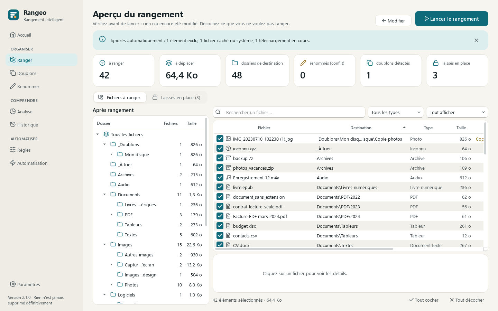
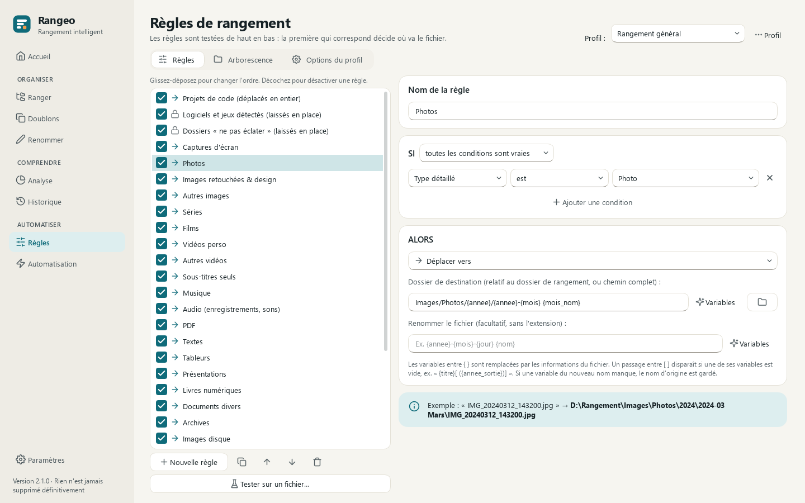
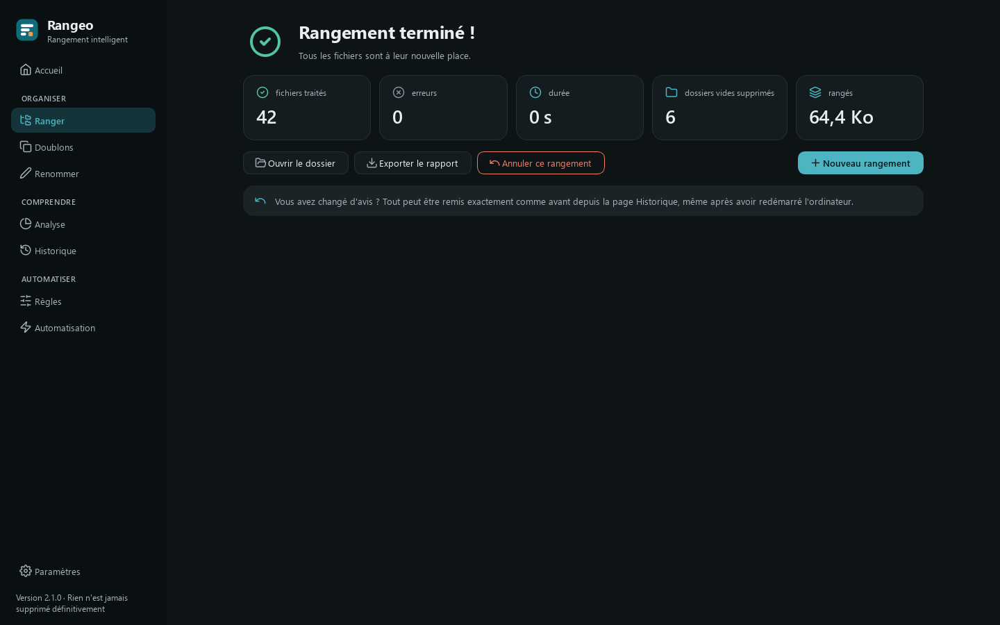

<div align="center">


# Rangeo

**Le rangement de disques pour Windows qui ne perd jamais un fichier.**

Photos, vidéos, musique, documents : Rangeo analyse, vous vérifiez, puis il range.
Tout est noté dans un journal et peut être annulé, même après un redémarrage.

[](../../releases/latest)


</div>

<p align="center">
  
</p>

## Pourquoi Rangeo

- **Rien ne bouge sans votre accord.** L'analyse ne modifie rien. L'aperçu montre chaque fichier, sa destination et
  pourquoi ; vous décochez ce que vous ne voulez pas.
- **Tout s'annule.** Chaque rangement, nettoyage, renommage ou tri de doublons est noté avant d'être fait.
  Un clic remet tout comme avant, même des jours plus tard.
- **Aucune perte possible.** Les copies vers un autre disque sont relues et comparées avant de supprimer l'original.
  Les suppressions passent par la corbeille. Après une coupure de courant, Rangeo reprend ou annule proprement.
- **Il respecte vos jeux et logiciels.** Les jeux, programmes, projets de code et collections de ROMs sont détectés
  et laissés entiers.
- **Rapide et hors ligne.** Pensé pour des disques jusqu'à 4 To. Aucune IA, aucun service en ligne, aucune donnée
  envoyée.

## Fonctionnalités

| | |
|---|---|
| **Ranger** | Arborescence claire et automatique : `Photos/2024/2024-03 Mars`, `Films/Titre (année)`, `Séries/Série/Saison 01`, `Musique/Artiste/Album`, `Documents/PDF/2023`… |
| **Doublons** | Fichiers identiques, mais aussi images, musiques et vidéos *ressemblantes* (redimensionnées, recompressées, converties). La meilleure qualité est gardée. |
| **Renommer** | Renommage en masse avec aperçu : date de prise de vue, lieu GPS, nettoyage des « (1) » et « Copie de », numérotation… |
| **Analyser** | Carte de l'espace disque, gros et vieux fichiers, temporaires, dossiers vides, installateurs obsolètes, fichiers abîmés. |
| **Règles** | Règles « SI … ALORS … » modifiables visuellement, profils, import/export JSON ou YAML. |
| **Automatiser** | Surveillance d'un dossier (Téléchargements), rangements planifiés (même Rangeo fermé), clés USB et cartes SD au branchement. |
| **Lieux** | Pays et ville des photos à partir du GPS, sans connexion Internet. |
| **Intégration** | Menu clic droit de l'Explorateur, ligne de commande, thème clair et sombre, français et anglais. |

<p align="center">
  
  
</p>

## Installation

1. Téléchargez **`Rangeo-2.1.0-Installation.exe`** depuis la [page des versions](../../releases/latest).
2. Lancez-le : l'installation se fait pour votre compte, sans droits administrateur.
3. Si Windows affiche « Windows a protégé votre ordinateur », cliquez sur **Informations complémentaires**, puis
   **Exécuter quand même**. Ce message apparaît parce que le programme n'est pas signé numériquement.

Pour désinstaller : *Paramètres Windows → Applications → Rangeo*. Votre historique est conservé.

**Conseil :** faites un premier essai sur un dossier sans importance, regardez le résultat, puis annulez depuis
l'Historique.

Le mode d'emploi complet est dans [docs/MODE_EMPLOI.md](docs/MODE_EMPLOI.md).

## Pour les développeurs

Python 3.12 · PySide6 (Qt) · SQLite · PyAV · NumPy · PyInstaller · Inno Setup.

```bat
lancer.bat        :: lancer depuis le code source
build.bat         :: tests + construction de dist\Rangeo\Rangeo.exe
installer.bat     :: installateur dist\Rangeo-<version>-Installation.exe
```

```bat
.venv\Scripts\python.exe -m pytest     :: 98 tests : reprise après coupure, annulation octet par octet, tests de torture…
```

Organisation : `rangeo/core` (moteur : scan, règles, plan, exécution, journal, annulation) · `rangeo/ui` (interface) ·
`rangeo/cli.py` (ligne de commande) · `tests` · `tools` · `installer`.

## Crédits

Données géographiques : [GeoNames](https://www.geonames.org) (licence CC BY 4.0).

---

<details>
<summary><b>English</b></summary>

**Rangeo** is a Windows disk organizer that never loses a file. It analyzes your folders, shows a full preview,
then sorts photos, videos, music and documents into a clean structure. Every operation is journaled and can be
undone, even after a reboot; cross-drive copies are verified before the original is removed; deletions go to the
Recycle Bin. Games, programs and code projects are detected and kept whole. It also finds exact and similar
duplicates, renames in bulk, analyzes disk space, and can watch folders or run on a schedule. Fully offline,
French and English UI.

Download the installer from the [releases page](../../releases/latest).

</details>
